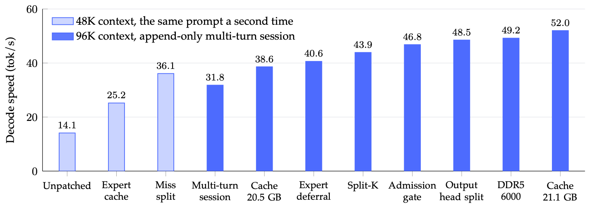
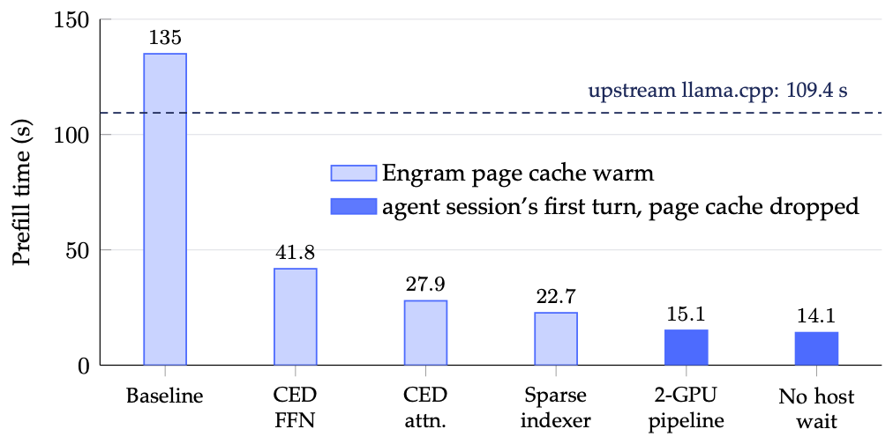

# Abyss

English | [中文](README.zh-CN.md)

Abyss runs DeepSeek-V4.1-Flash (763B parameters) at native MXFP4 precision on a single workstation with two GPUs. It places the model's weights in VRAM, host memory or NVMe according to how often they are used, and runs a model larger than the GPUs' memory on one machine with a series of patches to [mx-llama.cpp](https://github.com/mxxm-t/mx-llama.cpp) (a llama.cpp fork) and its scheduling logic.

## What it does

The native weights take about 474 GiB, more than this machine's VRAM and host memory combined. Abyss keeps the experts of layers 0–21 (all encoder layers and the first two decoder layers) resident in VRAM. The experts of the last 18 layers live in pinned host memory: an expert cache on the GPU holds the frequently used ones, and the CPU computes the misses directly. The two large Engram tables stay on NVMe and are read on demand. On top of this layout, a series of profiling-driven changes removes unnecessary computation, reads and waits:

- **Compute less, following the model's structure**: during prefill, the decoder layers compute only the tokens that later tokens can still see (CED-aware prefill); the official sparse attention indexer; decode attention gathers only the top-k rows.
- **Place data by heat**: a GPU expert cache with heat-based admission and eviction by decayed heat; misses go to the CPU.
- **Keep the CPU, PCIe and both GPUs busy at once**: experts computed on the CPU are added back to the residual one layer later (expert deferral); big prefill batches are split three ways between the CPU, GPU0 and the cache; long prompts are pipelined across the two GPUs.
- **Repeat less**: the tail of a prompt is computed in one pass, the previous turn's answer is no longer recomputed, and several unnecessary host synchronizations are gone.

Precision: the routed experts stay in native MXFP4, with no quantization below 4 bits. Every change is cross-checked against the version before it; the only approximation that changes the computation is expert deferral, and its effect on decode-path perplexity is within the error bars. Details are in the technical report.

## Results

*Single-stream decode speed as the optimizations were added. Light bars: 48K context, the same prompt generated a second time, so expert-cache hits run high. Dark bars: 96K context, an append-only multi-turn session; each bar is the "after" side of that change's own A/B test. Upstream llama.cpp on the same session: 39.3 tok/s.*

*Prefill time of a 48K-token prompt. Light bars: Engram page cache warm. Dark bars: an agent session's first turn with the page cache dropped. Dashed line: upstream llama.cpp with the same weights and launch settings, page cache dropped. Both charts are Figure 1 of the [technical report](report/report-en.pdf).*

On the machine below (November 2026; the numbers come from the technical report):

- Decode: about 52 tok/s in an append-only multi-turn session with 96K context, and about 50 tok/s per request in production; the unpatched mx-llama.cpp ran at 14.1 tok/s.
- Prefill: about 14 s for a new 48K-token prompt (about 3,400 tok/s) and about 27 s for 96K tokens; each later turn of an agent session (1,000–2,300 new tokens) takes about 2 s.
- Context: 192K tokens.

Against upstream llama.cpp (2026-11-07, with the same weights and launch parameters, measured the same day; Abyss's prefill has become about 35% faster since):

| | Abyss | Upstream llama.cpp |
|---|---:|---:|
| Decode, multi-turn session at 96K context | 49.2 tok/s | 39.3 tok/s |
| Prefill, new 48K-token prompt | 21.0 s | 109.4 s |
| Prefill, new 96K-token prompt | 41.7 s | 220.5 s |
| Prefill, each later agent turn | 2.36 s | 4.38 s |

We also ran subsets of three public agent benchmarks with their data and clients (one slot, concurrency 1); for the same work, Abyss took about half as long as upstream. These are not official results; see the notes below and [benchmark/README.md](benchmark/README.md).

## Hardware

- GPU: 2 × NVIDIA RTX PRO 6000 Blackwell Max-Q (96 GB each), PCIe 5.0 x8 / x8, no NVLink
- CPU: AMD Ryzen 9 9950X (16 cores)
- Memory: 4 × 48 GB DDR5, dual channel, 6000 MT/s
- Storage: Samsung 9100 PRO 4 TB (PCIe 5.0), holding the Engram tables

The IOMMU must be disabled in the BIOS: with it on, direct copies between the two GPUs report success but write nothing. The layer split, the expert cache size and the switches are tuned for this machine and need retuning on other hardware.

## Repository layout

| Path | Contents |
|---|---|
| [mx-llama.cpp/](mx-llama.cpp/README.md) | 46 patches (`0001`–`0046`), the V4.1 chat template and two small tools; its README lists what each patch does, its switch, and the commands to apply them |
| [llama.cpp/](llama.cpp/README.md) | The same changes being ported to upstream llama.cpp (in progress): patches on upstream commit `2cbe0ec`; production still runs on mx-llama.cpp |
| [tools/convert/](tools/convert) | Converting the official weights to GGUF (`v41convert.py`), changing one tensor's type, and converting to upstream llama.cpp's layout |
| [tools/eval/](tools/eval) | Scripts for cross-checks, benchmarks and profiling |
| [tools/restart-server.sh](tools/restart-server.sh) | The production server's launch script, with every switch |
| [benchmark/](benchmark/README.md) | Scripts and results for the three public benchmarks |
| [report/](report/README.md) | The technical report in English (`report-en.pdf`) and Chinese (`report.pdf`), with their LaTeX sources |
| [docs/](docs/scheduler.md) | The early scheduler design and the architecture figure |
| [CLAUDE.md](CLAUDE.md) | Detailed lab notes: the data, scripts and dates of every change, and this machine's quirks |

Apart from this README and the English report, the documentation is in Chinese.

## How to use

1. **Build**: check out mx-llama.cpp at commit `c4d12e2`, apply the patches in the order given in [mx-llama.cpp/README.md](mx-llama.cpp/README.md), and build with CUDA (`-DCMAKE_CUDA_ARCHITECTURES=120`).
2. **Weights**: download [deepseek-ai/DeepSeek-V4.1-Flash-1017](https://huggingface.co/deepseek-ai/DeepSeek-V4.1-Flash-1017), take [mxxm-t's MXFP4 GGUF](https://huggingface.co/mxxm-t/DeepSeek-V4.1-Flash-GGUF) as the template, and convert with `tools/convert/v41convert.py`. The result is about 383 GiB (see Section 9 of the technical report).
3. **Launch**: the full launch command is in Appendix B of the technical report; `tools/restart-server.sh` is the production script, so adjust its paths to your machine.
4. **Cross-checks and benchmarks**: the scripts in `tools/eval/` assume this machine's directory layout (`~/src/mx-llama.cpp`, `~/models`, `~/abyss-eval`), and most of it can be changed with environment variables. Stop the server before running them.

## Notes

- This is an experimental project built on one machine, not a general-purpose inference framework.
- The numbers in `benchmark/` come from subsets we ran ourselves and serve only to compare Abyss with upstream llama.cpp. The MLPerf Agentic Inference runs used only its data and client and do not follow MLPerf's rules, so they are not MLPerf results and were not verified by MLCommons Association (Result not verified by MLCommons Association). The AgentX and TraceLab runs are not valid submissions either.
- MLPerf is a trademark of MLCommons Association. This project is not affiliated with DeepSeek, NVIDIA, MLCommons or SemiAnalysis.

## License

MIT; see [LICENSE](LICENSE). Some files come from or are adapted from other projects (mx-llama.cpp / llama.cpp, DeepSeek, MLCommons); see [THIRD_PARTY_NOTICES.md](THIRD_PARTY_NOTICES.md).
