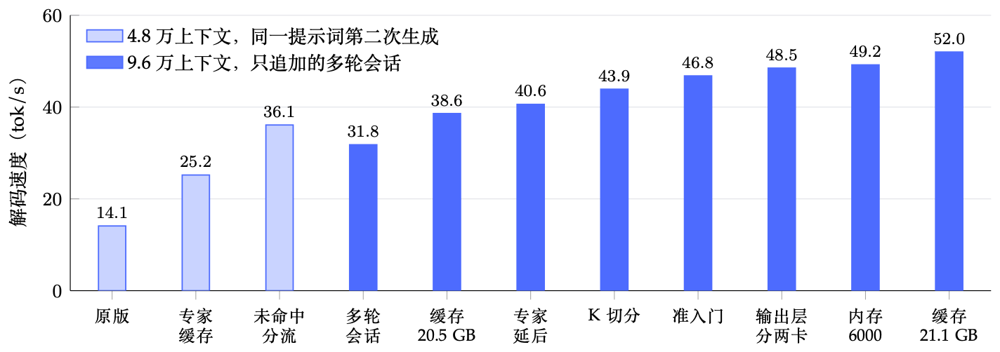
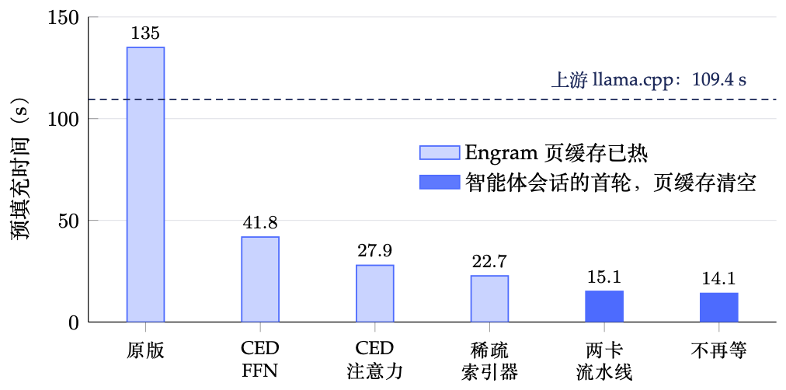

# Abyss

[English](README.md) | 中文

在一台双卡工作站上，以原生 MXFP4 精度运行 DeepSeek-V4.1-Flash（总参数 763B）：模型权重按访问热度分布在显存、内存和 NVMe 三层，用一组 [mx-llama.cpp](https://github.com/mxxm-t/mx-llama.cpp) 补丁和调度逻辑，在单机上跑超出显存容量的大模型。

## 做了什么

原生权重约 474 GiB，超过这台机器显存加内存的总量。Abyss 的做法：第 0–21 层（全部编码器层和前两层解码器层）的专家常驻显存；后 18 层的专家放在锁页内存里，GPU 上留一块专家缓存放常用的，未命中的由 CPU 直接算；两张 Engram 大表留在 NVMe 上按需读取。在这个布局上，按剖析逐项去掉多余的计算、读取和等待，主要有：

- **顺着模型结构少算**：预填充时解码器层只算后面还看得到的 token（CED 感知预填充）；补上官方的稀疏注意力索引器；解码注意力只取 top-k 行。
- **按热度放数据**：GPU 专家缓存，按热度准入、按衰减热度淘汰，未命中交给 CPU。
- **让 CPU、PCIe 和两张 GPU 同时干活**：CPU 算的专家晚一层加回残差（专家延后）；预填充的大批次分给 CPU、GPU0 和缓存三路；长提示词在两张卡上流水。
- **少重复**：提示词末段一遍算完，上一轮的回答不再重算，去掉主机上几处不必要的同步。

精度：路由专家是原生 MXFP4，不做低于 4 bit 的量化；每项改动都和改动前对拍，唯一改变计算的近似是专家延后，解码路径的 PPL 差别在误差以内。详见技术报告。

## 结果

*单流解码速度随各项优化的变化。浅色柱：4.8 万上下文、同一提示词第二次生成，专家缓存命中偏高；深色柱：9.6 万上下文、只追加的多轮会话，各取那项改动自己那次对比里「改动后」的数。同样的会话上，上游 llama.cpp 是 39.3 tok/s。*

*4.8 万 token 提示词的预填充时间。浅色柱：Engram 页缓存已热；深色柱：智能体会话的首轮，页缓存清空；虚线：同一份权重、同样启动参数下的上游 llama.cpp，页缓存清空。两张图都是[技术报告](report/report.pdf)的图 1。*

在下面这台机器上（2026 年 11 月，数字取自技术报告）：

- 解码：只追加的多轮会话里约 52 tok/s（9.6 万上下文），生产上按请求约 50 tok/s；最开始的 mx-llama.cpp 是 14.1 tok/s。
- 预填充：4.8 万 token 的新提示词约 14 s（约 3,400 tok/s），9.6 万 token 约 27 s；智能体会话之后每轮（1,000–2,300 个新 token）约 2 s。
- 上下文 19.2 万 token。

和上游 llama.cpp 比（2026-11-07，同一份权重、同样的启动参数、同一天测；之后 Abyss 的预填充又快了约 35%）：

| | Abyss | 上游 llama.cpp |
|---|---:|---:|
| 解码，9.6 万上下文的多轮会话 | 49.2 tok/s | 39.3 tok/s |
| 4.8 万 token 新提示词的预填充 | 21.0 s | 109.4 s |
| 9.6 万 token 新提示词的预填充 | 41.7 s | 220.5 s |
| 智能体之后每轮的预填充 | 2.36 s | 4.38 s |

另外用三个公开智能体 benchmark 的数据和客户端跑了子集（单槽位、并发 1），同样的工作量 Abyss 用时约为上游的一半。这些不是官方结果，见下面的说明和 [benchmark/README.md](benchmark/README.md)。

## 硬件

- GPU：2 × NVIDIA RTX PRO 6000 Blackwell Max-Q（每张 96 GB），PCIe 5.0 x8 / x8，没有 NVLink
- CPU：AMD Ryzen 9 9950X（16 核）
- 内存：4 × 48 GB DDR5，双通道，6000 MT/s
- 存储：Samsung 9100 PRO 4 TB（PCIe 5.0），放 Engram 表

BIOS 里的 IOMMU 要关：开着时两卡之间的直接拷贝会返回成功、数据却没写进去。层切分、专家缓存大小和各项开关都是按这台机器调的，换一套硬件要重新调。

## 仓库内容

| 位置 | 内容 |
|---|---|
| [mx-llama.cpp/](mx-llama.cpp/README.md) | 46 个补丁（`0001`–`0046`）、V4.1 的对话模板和两个小工具；README 里有每个补丁的作用、开关和打补丁的命令 |
| [llama.cpp/](llama.cpp/README.md) | 把这些改动移到上游 llama.cpp 上：代码在本仓库的 `llama-cpp` 分支（上游提交 `2cbe0ec` 的文件树，上面每项改动一个提交），这个目录里是提交的对照表和设置。2026-11-12 起生产在它上面试运行 |
| [tools/convert/](tools/convert) | 从官方权重转换 GGUF（`v41convert.py`）、换一个张量的类型、改成上游 llama.cpp 的布局 |
| [tools/eval/](tools/eval) | 对拍、测速和剖析脚本 |
| [tools/restart-server.sh](tools/restart-server.sh) | 生产 server 的启动脚本，带全部开关 |
| [benchmark/](benchmark/README.md) | 三个公开 benchmark 的运行脚本和结果 |
| [report/](report/README.md) | 技术报告：中文版 `report.pdf`、英文版 `report-en.pdf`，以及它们的 LaTeX 源文件 |
| [docs/](docs/scheduler.md) | 早期的调度器设计和架构图 |
| [CLAUDE.md](CLAUDE.md) | 详细的实验记录：每项改动的数据、脚本、日期和这台机器的注意事项 |

## 怎么用

1. **编译**：取 mx-llama.cpp 的提交 `c4d12e2`，按 [mx-llama.cpp/README.md](mx-llama.cpp/README.md) 的顺序打补丁，用 CUDA 编译（`-DCMAKE_CUDA_ARCHITECTURES=120`）。
2. **权重**：下载 [deepseek-ai/DeepSeek-V4.1-Flash-1017](https://huggingface.co/deepseek-ai/DeepSeek-V4.1-Flash-1017)，再拿 [mxxm-t 的 MXFP4 GGUF](https://huggingface.co/mxxm-t/DeepSeek-V4.1-Flash-GGUF) 作模板，用 `tools/convert/v41convert.py` 转换，结果约 383 GiB（做法见技术报告第 9 节）。
3. **启动**：完整的启动命令在技术报告的附录 B，`tools/restart-server.sh` 是生产用的脚本，路径按自己的机器改。
4. **对拍和测速**：`tools/eval/` 的脚本默认按这台机器的目录布局（`~/src/mx-llama.cpp`、`~/models`、`~/abyss-eval`），大多可以用环境变量改；运行前要先停掉 server。

## 说明

- 这是在一台机器上做的实验性项目，不是通用的推理框架。
- `benchmark/` 里的数字是自己跑的子集，只用来比较 Abyss 和上游 llama.cpp。其中 MLPerf Agentic Inference 那一项只用了它的数据和客户端，不符合 MLPerf 的规则，不是 MLPerf 结果，没有经过 MLCommons 验证（Result not verified by MLCommons Association）；AgentX 和 TraceLab 也不是有效提交。
- MLPerf 是 MLCommons Association 的商标。本项目和 DeepSeek、NVIDIA、MLCommons、SemiAnalysis 都没有关联。

## 许可证

MIT，见 [LICENSE](LICENSE)。有些文件来自或改自其他项目（mx-llama.cpp / llama.cpp、DeepSeek、MLCommons），见 [THIRD_PARTY_NOTICES.md](THIRD_PARTY_NOTICES.md)。
